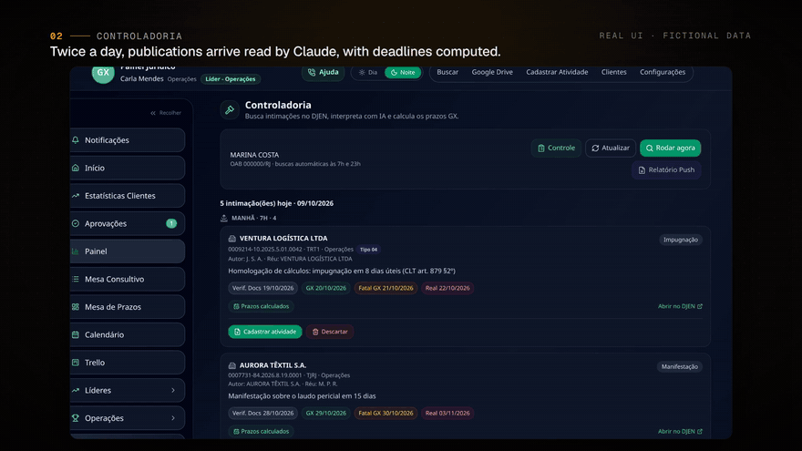
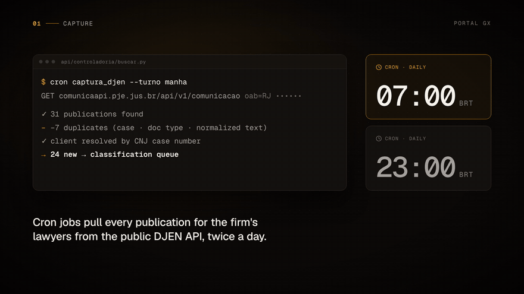
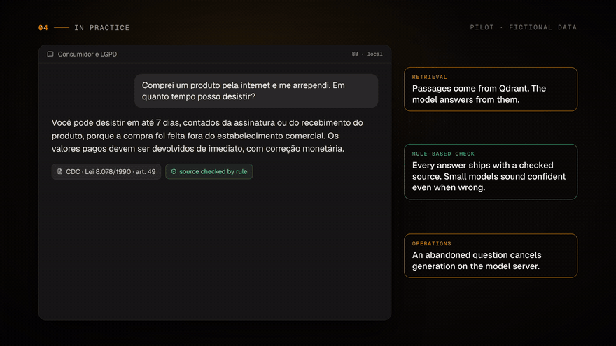
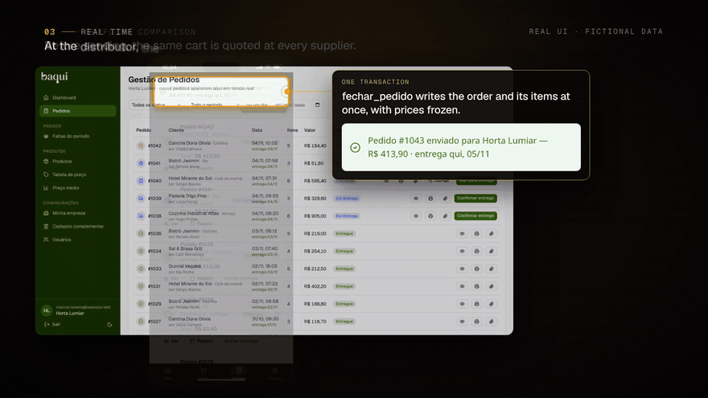

# Hi, I'm Juan 👋

AI Engineer in Rio de Janeiro. I build LLM systems for lawyers and keep them running.

- **In production:** I'm the sole engineer behind an AI-driven legal platform. An LLM reads the court gazette every morning and classifies each publication, and a human confirms it in one click. Every decision is logged. The LLM never calculates a deadline — that's deterministic code. → [case study](https://github.com/jmilheiro73/legal-ops-ai)
- **Triage agent:** on top of that pipeline, a Claude agent with five read-only tools checks each publication against the case history and the open tasks, and returns a typed proposal: register, dismiss or send to a human. Nothing leaves the queue without a lead's approval, and every agent version is evaluated offline against human decisions, with a temporal cut so the answer can't leak.
- **Building now:** an on-premise legal RAG for the same firm. My own FastAPI + LangGraph backend, Qdrant, an 8B open model on llama.cpp and Langfuse traces, scored against a 76-question answer key after every change.
- **In the open:** [legal-rag-eval](https://github.com/jmilheiro73/legal-rag-eval), the evaluation method behind that RAG: retrieval scored apart from generation and rule-based answer checks, on public Brazilian statutes. And [prax-chatbot](https://github.com/jmilheiro73/prax-chatbot), a LangGraph agent served by FastAPI over SSE. It has two-layer memory (Redis checkpoint with TTL + a SQLite summary) and every run is traced in LangSmith.
- **Next:** a RAG on pgvector with Recall@K measured, then an agent with evals on top of it.

### See it running

Narrated videos with the real interfaces running on fictional data. Click a GIF to watch the full video on my portfolio.

<table>
  <tr>
    <td width="50%"><b>Portal GX · system tour</b> LLM triage of court publications, in production since 2025 · <a href="https://github.com/jmilheiro73/legal-ops-ai">case study</a></td>
    <td width="50%"><b>Portal GX · how it works</b> The model interprets, code decides, a human clicks last</td>
  </tr>
  <tr>
    <td></td>
    <td></td>
  </tr>
  <tr>
    <td><b>On-premise legal RAG</b> Retrieval and answers measured separately · <a href="https://github.com/jmilheiro73/legal-rag-eval">eval method</a></td>
    <td><b>Baqui</b> B2B produce marketplace, Row Level Security, real time · <a href="https://github.com/jmilheiro73/baqui-case-study">case study</a> · <a href="https://baqui.vercel.app">live</a></td>
  </tr>
  <tr>
    <td></td>
    <td></td>
  </tr>
</table>

### Things I've shipped

**Portal GX AI** — court gazette triage with structured output. Prompts are validated against the firm's expert-labeled answer key before any change goes live.

**PJe Agent** — logs into the labor court portal with a digital certificate and 2FA, pulls case updates, summarizes and ranks them by severity. Circuit breaker, throttling, heartbeat, cloud watchdog. Reverse-engineered the undocumented API to turn a full scan into a handful of requests.

**Baqui** — B2B agtech SaaS. Multi-tenant Postgres with Row Level Security; the permission matrix is tested against the database before every migration.

**Central 4CAP** — weekly production board for a creative studio.

**Pentest TechStore** — a deliberately vulnerable app I built to break, plus the report (OWASP Top 10:2025, CVSS 3.1).

### Stack

Python · FastAPI · LangGraph / LangChain · Claude API · Qdrant · Redis · PostgreSQL / Supabase · TypeScript · React / React Native · Playwright · Vercel

Security is not a separate skill for me — RBAC, row-level isolation, mTLS and JWT show up in everything above.

### Elsewhere

[Portfolio](https://juan-milheiro.vercel.app) · [LinkedIn](https://linkedin.com/in/juan-milheiro-b95a8631b) · jotta4bjj@gmail.com
